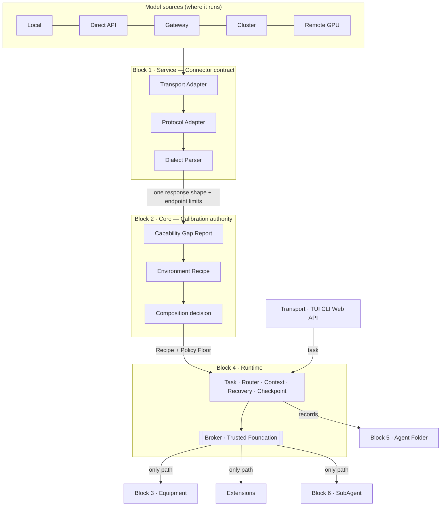

# Architecture IV — Model-Adaptive BOI Agent Suit

Status: **design baseline**, accepted with [ADR-006](ADR-006-calibration.md) on
2026-11-02. Target release: v3.0.0. Work plan:
[`ARCHITECTURE_IV_RENOVATION.md`](../planning/ARCHITECTURE_IV_RENOVATION.md).

> Core does not pick the best model. It makes the model it was given work as
> well as that model really can.

Two criteria judge every design in this document:

- **Changing the model never means rebuilding the Agent Suit.** Model
  differences end in an Adapter and a Recipe.
- **Adding a capability never means rebuilding Core.** New capabilities arrive
  as Extensions through a contract.

Architecture IV keeps the six Blocks and what already works (Broker, Tool
Registry, evidence ledger, file protections). It replaces how the Runtime is
*decided and composed*. It is not a rewrite.

## 1. Six Blocks, responsibilities restated

No seventh Block is added. The Connector is a contract inside Service; the
Broker is the trusted part of Runtime.

| Block | Owns in Architecture IV | Code today | Kind |
|---|---|---|---|
| 1 Service | Detects the environment and dependencies, reports Provider and MCP availability, and holds the **Connector** to every model source | `internal/service` (`provider/adapters`, `factory`, `catalog`, `config`) | PLUG |
| 2 Core | **Calibration authority**: Capability Gap Report → Environment Recipe → composition decision; identity and Persona | `internal/core` | FIXED |
| 3 Various Equipment | Built-in capabilities: Tools, Skills, Knowledge, Memory, Context Manager, adapters a Recipe can attach | `internal/equipment` | PLUG |
| 4 Runtime | Executes a task under a Recipe: lifecycle, Router, context, scheduling, recovery, checkpoints; the **Broker** (policy, approval, secret isolation, audit) | `internal/runtime` | FIXED |
| 5 Agent Folder | Outputs, task state, evidence, handoff between sessions | `internal/agentfolder` | PLUG |
| 6 SubAgent | Delegated work; a child goes through the same Broker | `internal/subagent` | PLUG |

Transport (TUI, CLI, Web, API) is outside the six Blocks: `internal/transport`.
It renders and takes input; it decides nothing.

Core decides **what** to compose. Runtime and Equipment are responsible for
**how** it is done.

## 2. What is locked and what is replaceable

| Tier | Members | Rule |
|---|---|---|
| **Trusted Foundation** | Broker and permission enforcement, secret isolation, sandbox and workspace boundaries, evidence ledger, schema validation, recovery limits | No plug-in replaces it. Changes only through reviewed, tested core development. |
| **Built-in components** | Model adapters, dialect parsers, Tool packs, Skill loader, knowledge retriever, context manager, planning strategies, verifiers | Replaceable through their interface, never in a way that weakens the tier above. |
| **Extensions** | Custom Tools, Skills, workflows, Agent templates, knowledge packs, MCP connectors, SubAgent packs, specialised verifiers | Built, tested, installed, enabled, disabled and removed without changing Core. |

The active registry stays at most 15 Tools and 15 Skills until there is
evidence that the ceiling should move.

Limitation, recorded in D7: the "sandbox" of `process.run` today is the
workspace path boundary plus a best-effort command deny-list
(`internal/equipment/tools/process/sandbox.go`). It is not OS-level isolation.

## 3. Supporting every model: two axes

A model has a value on each axis. A MoE model behind a gateway is both.

**Axis 1 — where it runs. Handled by an Adapter in Service.**

| Source | The Adapter handles |
|---|---|
| Local CPU/GPU (llama.cpp, Ollama) | memory, quantization, slow first load, long timeouts |
| Local OpenAI-compatible server (LM Studio, vLLM) | streaming, tool-call dialect, no auth |
| Hosted API (OpenAI, Anthropic, Google, DeepSeek) | tokens, rate limits, quota, parameter names |
| Gateway (OpenRouter, Maxplus, LiteLLM) | protocol translation, upstream errors, missing streaming, a model that changes behind the same name |
| Cluster (several endpoints or replicas) | routing, health, retries, keeping one task on one replica |
| Remote GPU server | connection, auth, recovery after a drop |

**Axis 2 — what the model is. Handled by the Recipe in Core.**

| Trait | Typical gap | Recipe |
|---|---|---|
| Mini (≤ 8B, flash) | weak multi-step reasoning, imprecise formats | plan first, small steps, fewer Tools, frequent verification |
| MoE (DeepSeek, Qwen) | its own tool-call dialect, uneven latency | dialect parser for the family, realistic timeouts |
| Reasoning / thinking | `reasoning_content` must be replayed on every assistant message once Tools are used | replay it |
| Large general model | few | native tools, parallel calls |

Which of these are observed and which are expected is tracked in the plan;
none of the Mini or Cluster rows has been observed yet.

## 4. Router rules

- The Router chooses a **Provider + Recipe** pair able to do the task, not a
  Provider that passed a gate. A 3B and a 70B model may both take part if
  completion works; they get different Recipes.
- A shared Policy Floor applies in the first implementation; Recipes are kept
  per endpoint from the start.
- A failover uses the new Provider's Recipe and re-checks the approval bound to
  that risk. No Provider's probe results are claimed for another.
- No right grows from a retry or a Provider switch.

## 5. Contracts — v0

Four contracts carry Architecture IV. Each is versioned, has a schema, and has
a conformance test that any implementation must pass. **v0 is a draft**: fields
may change until they are frozen in Phase 6. A breaking change after the freeze
needs a new major contract version and an ADR.

### 5.1 Connector (Service)

Purpose: one shape for talking to any model source.

Today: `llm.Provider` (`Name`, `Complete`), `llm.ToolCaller`,
`CompletionRequest` (`Messages`, `MaxTokens`, `Temperature`, `Tools`,
`OnText`) and `CompletionResponse` (`Content`, `ToolCalls`, usage, `Model`,
`Provider`, `FinishReason`, rate limits) in `internal/runtime/llm/provider.go`.
One OpenAI adapter currently does transport, protocol and dialect work at once.

v0 adds:

- Three layers behind the one interface: **Transport Adapter** (connection,
  auth, health, retry), **Protocol Adapter** (OpenAI Chat, Anthropic Messages,
  Google), **Dialect Parser** (DSML, Hermes, Qwen XML into `ToolCalls`).
- **Endpoint facts** the Connector reports to Core: streams or not, native
  tools or not, parameter names, whether reasoning must be replayed.
- `ReasoningContent` carried on a message and replayed when the endpoint
  requires it.
- A recorded reason whenever the Connector falls back (native → text, stream →
  whole response). A silent fallback is a contract violation.

Conformance: every adapter passes the same fixtures, including the simulated
endpoints of Phase 0.

### 5.2 Recipe (Core → Runtime)

Purpose: how this Runtime equips this model. It is new in Architecture IV.

v0 fields (indicative):

| Field | Meaning |
|---|---|
| `version`, `profile_fingerprint`, `endpoint` | identity; a Recipe belongs to one endpoint and one profile |
| `capabilities` | for each capability: `NATIVE`, `ASSISTED`, `UNVERIFIED` or `BLOCKED`, with the evidence reference |
| `tool_protocol` | `native`, `envelope`, or `dialect:<name>` |
| `repair_attempts` | bounded retries with a precise error for malformed calls |
| `approval_floor` | `none` or `confirm` (D1) |
| `budgets` | steps, Tool calls, timeouts, scaled for the model |
| `context_policy` | clip size, when to summarise |
| `plan_first`, `max_parallel_calls` | pacing for weaker models |

Invariants: a Recipe never grants a right the Policy Floor withholds; changing
a Recipe produces a new version; only declared fields may change between
versions; a candidate version runs in shadow before it is promoted and can be
rolled back.

### 5.3 Extension (Equipment, Extensions)

Purpose: anything added to an Agent, by the user or by the Agent itself.

Today: `block.PackManifest` (`schema_version`, `id`, `kind`, `version`,
`provides`, `requires.runtime`, `requires.capabilities`, `max_risk`) in
`internal/block/pack.go`, with Tool packs and Skill packs.

v0 extends it as `extension.yaml` with: the rights it requests, its
dependencies, resource limits, how to test it, and how to roll it back.
Invariants: an Extension cannot raise its own rights, cannot replace the
Trusted Foundation, cannot read secrets, and cannot widen the workspace scope
through another channel. Approval follows D5.

### 5.4 Event (Runtime → Transport, Agent Folder)

Purpose: what happened, in a form a person, a transport and a later session can
all rely on.

Today: `agent.EngineEvent` (`Kind`, `Phase`, `Step`, `ToolCall`, `ToolResult`,
`StopReason`, `Verification`, `Plan`) and `agent.RuntimeEvent` (`Approval`,
`Engine`, `Result`, `Partial`, `Err`) in `internal/runtime/agent`.

v0 adds: a schema version, the Recipe version in force, each capability's
status as it was used, and the recorded reason for any fallback. Invariant: no
event carries a secret.

### 5.5 Foundation amendments (Rule 4, 2026-11-03)

Contracts locked now because adding them later would change Core or stored
data. Only the shapes are fixed; each is built in the phase shown.
Source: [`platform-principles`](../research/2026-11-03-platform-principles.md) §4.

| # | Amendment | Contract | Built in |
|---|---|---|---|
| F1 | **Identity.** Every event, checkpoint and effect carries host-assigned `task_id`, `agent_id`, `parent_agent_id`, `step`, `call_id`; checkpoints reserve `owner` and `lease_expires` (empty until a Cluster is observed). The model never names its own id. | Event, Agent Folder | Phase 3 |
| F2 | **Event envelope.** `schema_version`, a monotonic `seq` per task, `time`, the F1 ids, `recipe_version`, `kind`, a versioned `payload`. A reader accepts its own version and the one before; an unknown `kind` is skipped, never fatal. Reserved kinds: `model.switched`, `context.compacted`, `approval.requested`, `approval.decided`, `effect.recorded`, `mode.changed`, `capability.used`. | Event | Phase 1–3 |
| F3 | **Typed content parts.** `Message` content becomes parts (`text` now; `image` and others later). A part type the endpoint facts do not declare is refused with a reason, never dropped. `vision` is a capability, `UNVERIFIED` by default; captioning through Equipment would be `ASSISTED`. | Connector | Phase 1 |
| F4 | **Model switch.** A switch, by failover or by the user, emits `model.switched`, uses the new endpoint's Recipe, re-checks approvals, and drops non-portable state (such as `reasoning_content`) with a recorded reason. | Connector, Recipe (D3) | Phase 2 |
| F5 | **Persisted approval.** An approval is an event bound to the call fingerprint, the Recipe version and the Provider. Resume re-checks all three; a change invalidates it. An expired request is never approved by default (D2). | Event, Agent Folder | Phase 3 |
| F6 | **Effect record with pre-image.** A verified change records `call_id`, `path`, `pre_sha256`, `pre_ref`, `post_sha256`. `process.run` and network effects are `reversible: false`. Undo is a capability with a status: file edits can be undone; shell effects cannot, and the user is told. | Event, Agent Folder | Phase 3 |
| F7 | **Extension compatibility.** `extension.yaml` names the contract majors it targets, a namespace (`<publisher>/<id>`), the rights it requests and `depends_on` with version ranges. A mismatch is `BLOCKED: incompatible contract`. | Extension | Phase 4 |
| F8 | **Modes and hooks only narrow.** A permission mode (at most three: `plan` read-only, `default`, `confirm-all`) removes rights from the Policy Floor and never adds any. An authorisation hook or Extension may answer `deny` or `ask`, never `allow` past the floor; changing arguments after fingerprinting creates a new call that is authorised again. | Policy Floor (Trusted Foundation) | Phase 2 (modes), 4 (hooks) |
| F9 | **Transcript store.** Resume and fork need the conversation, which `TaskRecorder` today must not keep. Proposed: a separate opt-in store in the Agent Folder with redaction and retention. **Needs the owner's decision before any code** (plan rule 6). | Agent Folder | Phase 3 |

Not locked (would bloat Core if done now): agent-team messaging, a scheduler,
telemetry SDKs, vector stores, LSP clients, multimodal adapters before a vision
endpoint is in the zoo, distributed leases before a Cluster is observed, a
seventh Block.

## 6. Experience Contract

Guarantees the user sees whatever model, runtime or Extension is in use.
Each is checked by a test before it may be claimed (ADR-006, Experience
acceptance).

| # | Guarantee | Delivered by | Proof |
|---|---|---|---|
| E1 | One instruction carries through; every stop says why and what the user can do next | Runtime lifecycle, `StopReason` | every exit path across the model zoo yields a valid stop and a notice |
| E2 | Progress is visible; the screen shows only what events say | Event contract, Transport | replaying a recorded event log reproduces the timeline |
| E3 | Switching the model does not break the task, and no right grows | Recipe, Connector, D3, F4 | zoo test: switch native → dialect endpoint mid-task |
| E4 | A crash loses no work and repeats no side effect | Agent Folder, Broker idempotency | Crash Recovery and Tool Replay rows |
| E5 | Changes can be undone, and what cannot be undone is said | F6 | undo restores pre-image hashes; `process.run` listed as not reversible |
| E6 | Limits are honest: `ASSISTED` is never shown as `NATIVE` | Gap Report, `capability.used` | rendered status equals the Recipe status for every zoo capability |
| E7 | Nothing is approved silently | Broker, Policy Floor, D1/D2/D5, F8 | a hook answering `allow` on a floor-denied call is still denied |
| E8 | Cost and budget are visible, with where the numbers came from | Runtime budgets, `Usage` | budget test stops with `budget_exhausted`; unknown cost shown as unknown |
| E9 | The same guarantees hold in every front end | Transport decides nothing | one scripted task through each Transport yields the same event kinds |
